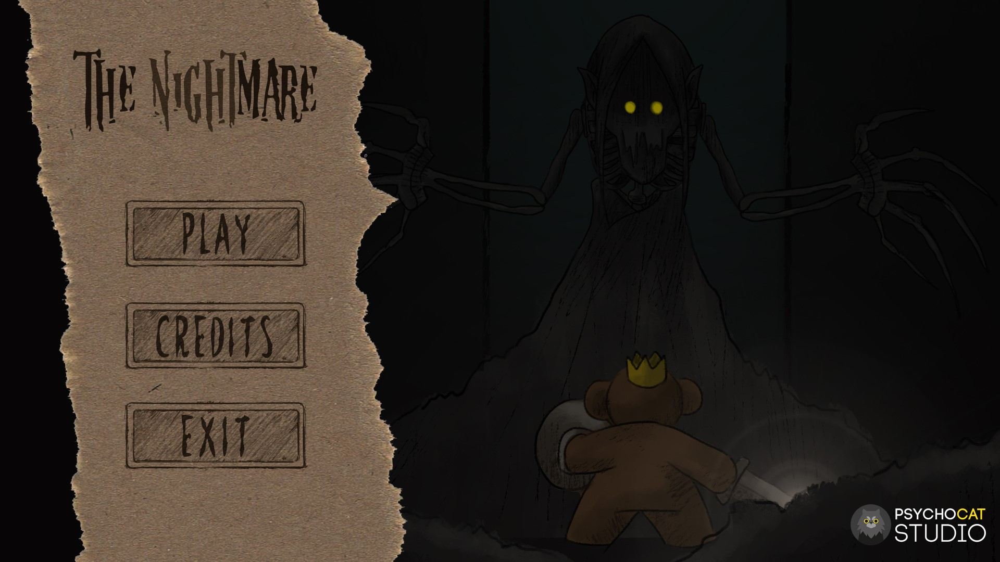
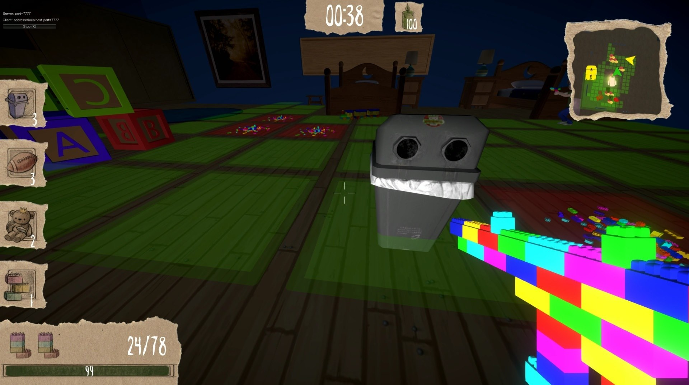
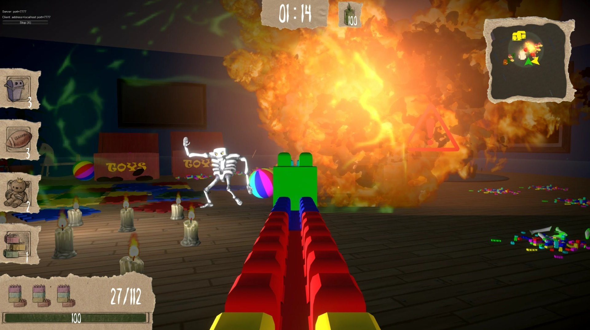
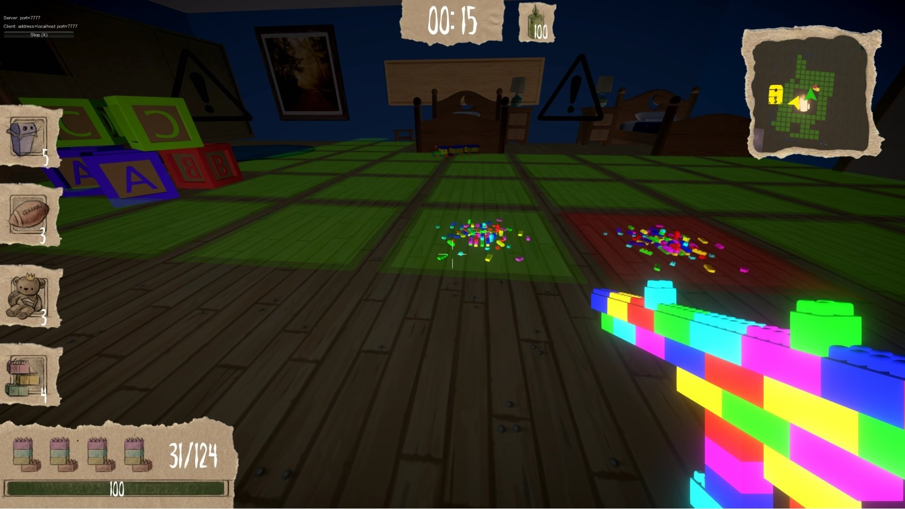

# The Nightmare
FPS multiplayer game. ZTGK (2019)

[](https://github.com/msuliborski/the-nightmare/actions/workflows/build.yml)
[](https://github.com/msuliborski/the-nightmare/actions/workflows/compile-check.yml)
</br>
<p align="center">
  
  
  
  
</p>

### About game
The siblings wake up in the nightmare that takes place in the astral version of their home. To get out of it, they have to work together in a fight against the monsters that emerge from the darkness. Children know that monsters will attack at midnight. They have to find the right toys and prepare their home to fight them. Any nightmare can be controlled, so they use their imagination to turn their toys into weapons. Children will only get out of the nightmare if they keep the light on in their rooms.

### Trailer
https://vimeo.com/344669557

### Download
All releases of the game are available on the GitHub page in the [releases](https://github.com/msuliborski/the-nightmare/releases) tab, for Windows, macOS and Linux.
Fresh test builds can be made with one click: **Actions → Build game → Run workflow** (see [docs/BUILDING.md](docs/BUILDING.md)).

### Multiplayer
One player hosts (*Create Room*), the others join from the server list (same network) or by typing the host's IP address.
For internet play the host forwards UDP port 7777 or everyone uses a virtual LAN such as Tailscale/ZeroTier.
Windows, macOS and Linux players can play together. Details in [docs/BUILDING.md](docs/BUILDING.md#playing-together).

## Getting Started
These instructions will get you a copy of the project up and running on your local machine for development and testing purposes.

### Prerequisites
In order to properly build application one might need to install [Unity](https://unity.com/releases/editor/archive) 2018.4.3f1.

### Cloning
```
$ git clone https://github.com/msuliborski/the-nightmare
```

### Building
Open the project in Unity 2018.4.3f1 and hit play, or use the **The Nightmare → Build** menu.
CI builds, license setup and a Unity-free compile check are described in [docs/BUILDING.md](docs/BUILDING.md).
Planned improvements: [docs/ROADMAP.md](docs/ROADMAP.md).

## Built with
* [Unity](https://unity.com/) - The world’s leading real-time creation platform

## Authors
* **Michał Suliborski** - [msuliborski](https://github.com/msuliborski)
* **Jędrzej Szor** - [jedrekszor](https://github.com/jedrekszor)
* **Michał Kuśmidrowicz** - [ninjarlz](https://github.com/ninjarlz)
* **Olga Kardas** - [OlgaKar](https://github.com/OlgaKar)
* **Adam Sabela** - [Drazzi0](https://github.com/Drazzi0)

## License
This project is licensed under the MIT License - see the [LICENSE.md](LICENSE.md) file for details
